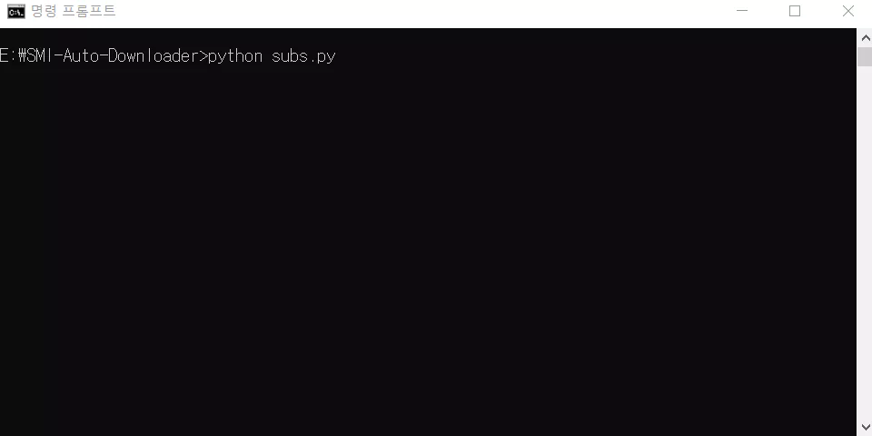
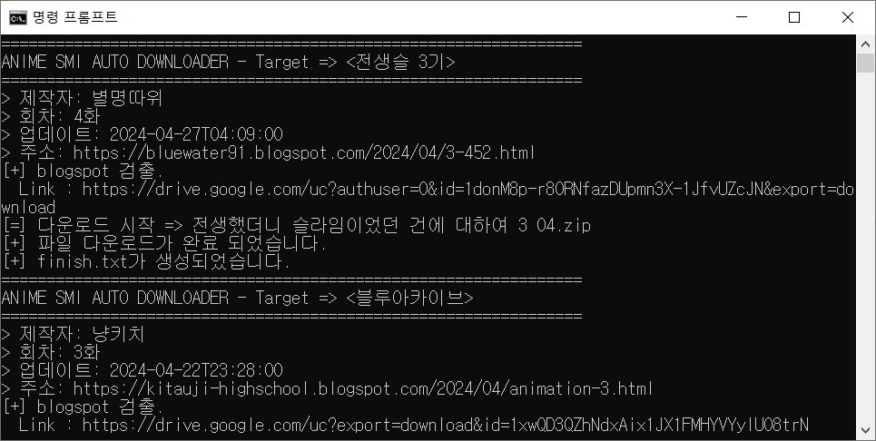
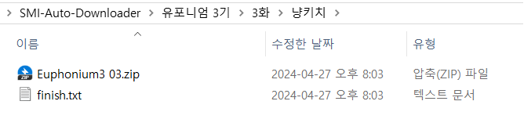

# SMI-Auto-Downloader

[](https://github.com/dhku/SMI-Auto-Downloader/releases)



자막 릴리즈시 자막을 일괄로 다운받게 해주는 프로그램 입니다.

[GUI Version Github (For Windows/Mac)](https://github.com/dhku/GUI-for-SMI-Auto-Downloader) 

## 사용방법 

1. **anime.yml** 에서 받고싶은 자막의 애니메이션을 추가합니다.

   ```
   download_path: "./output"
   anime_list: '[
       {
         "Anime":"전생했더니 슬라임이었던 건에 대하여 3기",
         "AnimeNo":"2593"
       }
     ]'
   ```

   * AnimeNo는 작품의 고유 번호입니다.
     * [애니시아 애니메이션 목록](https://anissia.net/anime)에서 작품을 선택하면 해당 작품의 url 끝 번호가 AnimeNo 입니다. 
     * 예시: https://anissia.net/anime/{작품번호}

   * Anime는 생성될 폴더 이름입니다. **(선택 사항)**

     * Anime를 생략하면 실행 시 애니시아에서 작품 제목을 가져와 폴더 이름으로 사용하고, **anime.yml**에도 **자동으로 채워 저장**합니다.
     * 제목에 폴더 이름으로 쓸 수 없는 문자(`< > : " / \ | ? *`)가 있으면 공백으로 바꿔 저장합니다.
     * Anime를 직접 입력한 경우에는 입력한 이름을 그대로 폴더 이름으로 사용합니다.
     * 자동 저장 시 **anime.yml** 파일 전체를 다시 쓰기 때문에, 파일에 작성한 주석은 사라집니다.

   * download_path는 자막 다운로드 경로 입니다. 

     * 경로 예시(시놀로지,리눅스)

       ```yaml
       download_path: "/volume1/Anime/Downloads"
       ```

     * 경로 예시(윈도우)

       ```yaml
       download_path: "E:\\SMI-Auto-Downloader/downloads"
       ```

     * 기본값 - 현재 디렉토리의 output 폴더에 저장됩니다.

       ```yaml
       download_path: "./output"
       ```

   * **anime.yml** 예제 (AnimeNo만 입력)

     ```yaml
     download_path: ""
     anime_list: '[
         {
           "AnimeNo":"2593"
         },
         {
           "AnimeNo":"2743"
         }
       ]'
     ```

     실행 후 다음과 같이 작품 제목이 자동으로 채워집니다.

     ```yaml
     download_path: ""
     anime_list: '[
         {
           "Anime":"전생했더니 슬라임이었던 건에 대하여 3기",
           "AnimeNo":"2593"
         },
         {
           "Anime":"전국요호",
           "AnimeNo":"2743"
         }
       ]'
     ```

2. 다음 명령어를 통해 프로그램을 실행합니다.

   ```shell
   python3 subs.py
   ```

   

   

3. 프로그램 실행후 다음과 같은 경로가 생성됩니다.

   

   * 생성경로 :  다운 받을 디렉토리 / 애니메이션 이름 / 회차 / 제작자 / ( *.zip or *.smi )

   * finish.txt : 정상적으로 파일 다운로드가 완료되면 생성되는 파일입니다. 

     finish.txt 에는 메타정보가 포함되어있으며 이후 finish.txt 존재시 해당 다운로드를 스킵합니다.

## 로컬에서 실행 (Windows)

실행 환경 : Windows 10 / 11

Docker 없이 Windows PC에서 직접 실행하는 방법입니다. 실행 파일(exe)을 사용하는 방법과 Python으로 실행하는 방법 중 하나를 선택합니다.

1. **실행 파일(exe)로 실행** - Python 설치가 필요 없습니다.

   1. [Releases](https://github.com/dhku/SMI-Auto-Downloader/releases) 페이지에서 최신 버전을 내려받아 원하는 폴더에 압축을 풉니다.

      ```
      C:\SMI-Auto-Downloader
      ├── output/
      ├── subs.exe
      ├── anime.yml
      └── start.bat
      ```

   2. **anime.yml**에 받을 작품을 설정합니다.

      ```yaml
      download_path: "./output"
      anime_list: '[
          {
            "AnimeNo":"2593"
          }
        ]'
      ```

   3. **start.bat**을 더블클릭하여 실행합니다. 실행이 끝나면 창이 멈춰 있으므로 결과를 확인한 뒤 아무 키나 눌러 닫습니다.

2. **Python으로 실행**

   1. [python.org](https://www.python.org/downloads/windows/)에서 Python 3.11 이상을 설치합니다. 설치 첫 화면에서 **Add python.exe to PATH**를 체크합니다.

   2. Github에서 받은 소스 폴더에서 명령 프롬프트(cmd) 또는 PowerShell을 열고 필요한 패키지를 설치합니다.

      ```shell
      cd C:\SMI-Auto-Downloader
      python -m pip install requests PyYAML beautifulsoup4 tqdm
      ```

   3. **anime.yml**을 설정한 뒤 프로그램을 실행합니다.

      ```shell
      python subs.py
      ```

      * Windows에서는 `python3` 대신 `python` 명령을 사용합니다.

3. **주기적으로 실행 (Windows 작업 스케줄러)**

   1. 시작 메뉴에서 **작업 스케줄러**를 열고 오른쪽의 **기본 작업 만들기**를 클릭합니다.

   2. **트리거**에서 실행 주기(매일 등)를 설정합니다.

   3. **동작**에서 **프로그램 시작**을 선택하고 아래와 같이 입력합니다.

      | 항목              | exe 사용 시                       | Python 사용 시           |
      | ----------------- | --------------------------------- | ------------------------ |
      | 프로그램/스크립트 | `C:\SMI-Auto-Downloader\subs.exe` | `python.exe`             |
      | 인수 추가         | (비워 둠)                         | `subs.py`                |
      | 시작 위치         | `C:\SMI-Auto-Downloader`          | `C:\SMI-Auto-Downloader` |

      * **시작 위치**는 반드시 입력해야 합니다. 프로그램은 시작 위치 폴더의 **anime.yml**을 읽고, `download_path`가 비어 있으면 이 폴더에 자막을 저장합니다.
      * **start.bat**은 마지막에 키 입력을 기다리므로 작업 스케줄러에는 등록하지 않습니다.

   4. 만든 작업의 속성에서 **트리거 → 편집 → 작업 반복 간격**을 설정하면 30분 간격 등으로 반복 실행할 수 있습니다.

## Docker를 이용한 방법 (NAS 권장)

실행 환경 : Synology / Linux / Windows

Python이나 패키지를 직접 설치하지 않고 Docker 컨테이너로 실행할 수 있습니다. 컨테이너는 1회 실행마다 자막을 받은 뒤 종료되므로, 스케줄러로 주기적으로 실행합니다.

1. Github에서 받은 파일을 NAS의 폴더에 넣습니다. (예: `/volume1/docker/SMI-Auto-Downloader`)

   ```
   /volume1/docker/SMI-Auto-Downloader
   ├── Dockerfile
   ├── docker-compose.yml
   ├── docker/entrypoint.sh
   ├── gdrive/
   ├── subs.py
   ├── anime.yml
   └── output/          # 자막이 저장되는 폴더
   ```

2. **docker-compose.yml**을 환경에 맞게 수정합니다.

   ```yaml
   services:
     smi-auto-downloader:
       build: .
       image: smi-auto-downloader:latest
       platform: linux/amd64
       container_name: smi-auto-downloader
       environment:
         - PUID=1026        # NAS 사용자 id
         - PGID=100         # NAS 그룹 id
         - TZ=Asia/Seoul
       volumes:
         - /volume1/docker/SMI-Auto-Downloader:/app        # anime.yml
         - /volume1/docker/SMI-Auto-Downloader/output:/app/output
       restart: "no"
   ```

   * `PUID`, `PGID` : 다운로드한 파일의 소유자가 됩니다. SSH에서 `id` 명령으로 확인한 NAS 사용자의 `uid`, `gid` 값을 입력합니다.
   * `volumes` : 왼쪽은 NAS의 실제 경로, 오른쪽은 컨테이너 내부 경로입니다. </br>자막을 다른 폴더에 받고 싶다면 두 번째 줄의 **왼쪽 경로만** 바꿉니다. </br>(예: `/volume1/Anime/Downloads:/app/output`)

     * 만일 자막을 다른 폴더에 받을시 해당 폴더의 읽기와 폴더 진입 권한을 부여해야합니다.

       ```
       sudo chmod u+rwx /volume1/Anime/Downloads # 애니메이션 동영상 폴더
       ```

3. **anime.yml**의 `download_path`는 **컨테이너 내부 경로** 기준이므로 `./output`으로 설정합니다. (기본으로 설정되어 있습니다)

   ```yaml
   download_path: "./output"
   anime_list: '[
       {
         "AnimeNo":"2593"
       }
       ]'
   ```

   * `/volume1/...` 같은 NAS 경로를 직접 적으면 컨테이너 안에서는 찾을 수 없습니다. 저장 위치는 2번의 `volumes`에서 변경합니다.

4. SSH 터미널에 접속하여 이미지를 빌드하고 실행합니다.

   ```bash
   sudo -i
   cd /volume1/docker/SMI-Auto-Downloader
   
   # 이미지 빌드 (최초 1회, subs.py 등 코드를 업데이트한 경우 다시 실행)
   docker compose build
   
   # 1회 실행
   docker compose run --rm smi-auto-downloader
   ```

   * DSM 7.2 미만 등 `docker compose` 명령이 없는 환경에서는 `docker-compose`를 사용합니다.
   
5. 주기적으로 실행하려면 시놀로지 **작업 스케줄러**에서 **생성 -> 예약된 작업 -> 사용자 정의 스크립트**를 만들고, 사용자를 **root**로 선택한 뒤 아래 명령을 추가합니다.

   ```bash
   cd /volume1/docker/SMI-Auto-Downloader
   docker compose run --rm smi-auto-downloader
   ```

   Linux에서는 Crontab을 이용합니다.

   ```bash
   */30 * * * * cd /home/user/SMI-Auto-Downloader && docker compose run --rm smi-auto-downloader # 예시) 30분 간격으로 실행...
   ```
